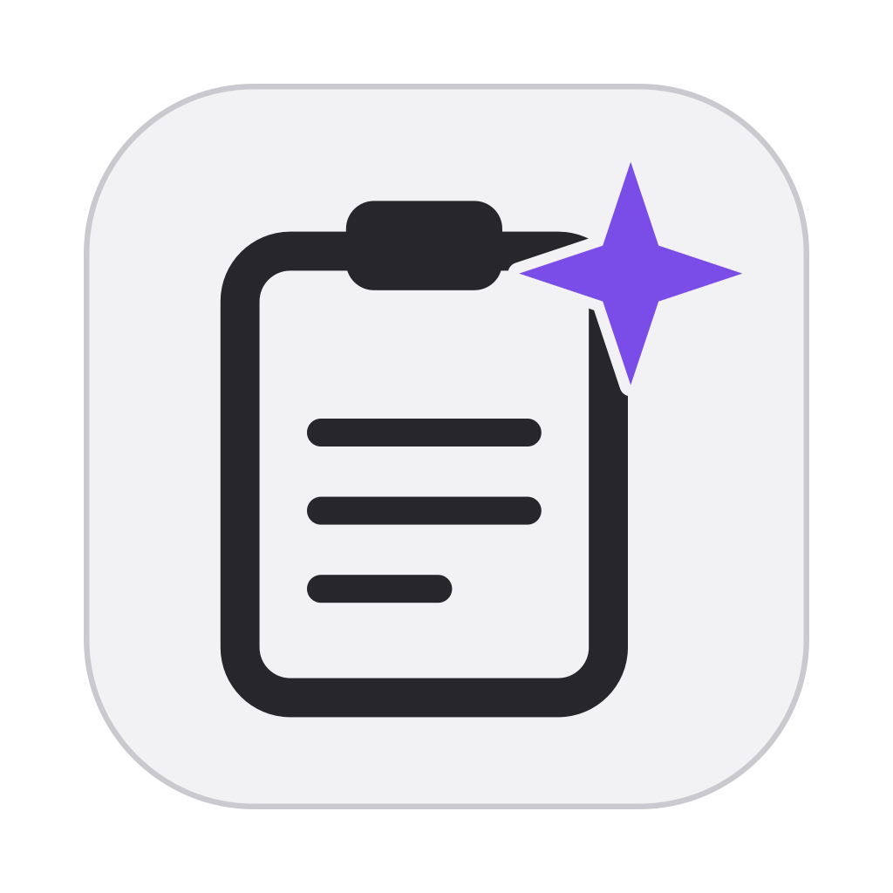
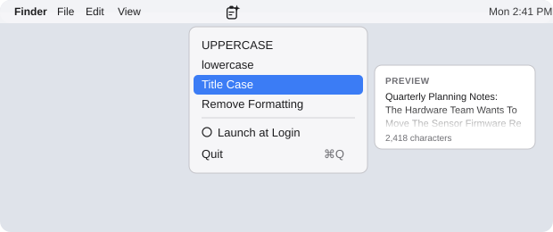

<div align="center">

<p></p>

# Clippy


</div>

A tiny macOS menu bar app that changes the text on your clipboard in one click. It has no Dock icon, no windows and no background polling, so it idles at about 0% CPU.

## Features

- **UPPERCASE**, **lowercase** and **Title Case**
- **Remove Formatting**: turns rich text (from web pages, Word, Pages, etc.) into plain text
- **Hover preview**: hover an option to see the first three lines of its result next to the menu
- **Launch at Login** toggle (uses the system Login Items)
- Plain Swift and AppKit, one source file, no dependencies

## Usage

1. Copy some text (`Cmd+C`).
2. Click the Clippy icon in the menu bar. Hover an option to preview the result, then click it to apply.
3. Paste (`Cmd+V`) the result.

<p align="center"></p>

The preview shows at most three lines of the transformed text plus the clipboard's character count, so a large clipboard never fills the screen.

| You copy | You choose | You paste |
| --- | --- | --- |
| `hello World` | UPPERCASE | `HELLO WORLD` |
| `Hello World` | lowercase | `hello world` |
| `the quick brown fox` | Title Case | `The Quick Brown Fox` |
| Bold, linked text from a web page | Remove Formatting | The same text, unstyled |

Notes:

- If the clipboard holds a file or an image, Clippy leaves it alone, so a copied file is never replaced by its file name.
- Title Case capitalizes the first letter of each word and lowercases the rest, so `iPhone NASA` becomes `Iphone Nasa`.

## Installation

You need macOS 14 or later and a Swift 6 toolchain (Xcode 16 or newer, or the matching Command Line Tools from `xcode-select --install`).

```bash
git clone https://github.com/azaets/clippy.git
cd clippy
./build.sh
open /Applications/Clippy.app
```

`build.sh` compiles the app, signs it ad hoc, and installs it to `/Applications/Clippy.app`. It quits a running copy first.

To start Clippy at login, click its menu bar icon and choose **Launch at Login**. Run the app from `/Applications`, because Login Items remembers the app's location. macOS may ask you to approve it in System Settings > General > Login Items.

Because the app is signed ad hoc, rebuilding it can leave a stale or duplicate entry in Login Items. If that happens, toggle **Launch at Login** off and on again.

To uninstall, choose **Launch at Login** to turn it off, quit Clippy, and delete `/Applications/Clippy.app`.

## Changing the icon

Edit `assets/icon.svg`, then regenerate the `.icns`:

```bash
swift assets/svg2icns.swift assets/icon.svg /tmp/Clippy.iconset
iconutil -c icns /tmp/Clippy.iconset -o assets/Clippy.icns
```

The menu bar icon is drawn in code in `Sources/main.swift`.
